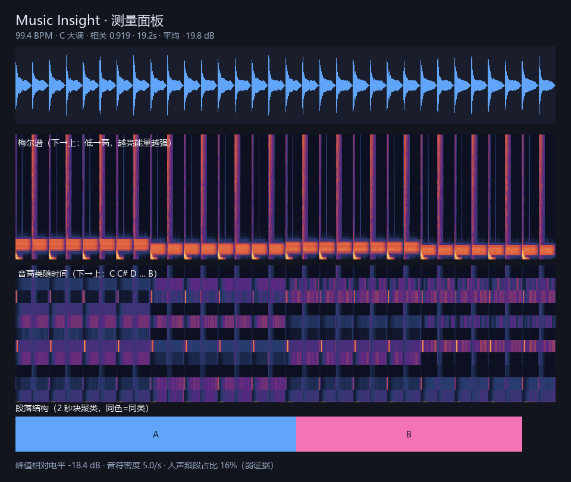

# music-insight

把音频转成 **LLM 可读的证据包**：客观测量 + 图 + 事实性报告。

文本模型读不到音频。这个项目不试图训练一个新的音乐模型，而是回到最朴素的办法：
**把音乐变成模型能读的东西**——数字、时间线、频谱图，以及一份每条结论都能追溯来源的报告。

```
音频 ──▶ 测量层（确定性算法）──▶ 证据层（JSON/CSV/PNG/Markdown）──▶ 任意 LLM 解读
```

纯 CPU、零 API、离线可跑。



## 它是什么 / 不是什么

| 是 | 不是 |
|---|---|
| 把音频变成可复现的测量数据 | 一个音乐理解模型 |
| 生成给 LLM 读的证据包和提示词 | 自动生成乐评的 SaaS |
| 明确标注情绪的置信度与失效条件 | 情绪识别 |
| 可以上基准检验的工具 | 和弦识别器、扒谱工具 |

## 快速开始

```bash
pip install -e ".[decode]"     # numpy + pillow + av（av 用于 mp3/m4a/flac）

# 生成一段无版权的测试音频（100 BPM，I–V–vi–IV，19.2 秒）
python examples/make_demo.py out/demo.wav

music-insight out/demo.wav --out out/demo

# 批量分析一个文件夹，输出汇总表
python examples/batch.py "某处/音乐文件夹" --out out/batch
```

输出：

```
out/demo/
├── panel.png      # 波形 + 梅尔谱 + 音高类 + 结构条（给视觉模型读）
├── analysis.json  # 全部测量值 + 结构 + 情绪先验 + 证据索引
├── timeline.csv   # 8 秒粒度的时间线
└── report.md      # 事实性报告，每条结论带字段引用
```

测试音频上的实测结果（可复现）：

| 指标 | 测得 | 真值 |
|---|---|---|
| BPM | 99.4 | 100 ✅ |
| 段落切分 | 0–10s / 10–18s | 和弦在第 2 小节换 ✅ |
| 调性 | F 大调（相关 0.806） | C 大调 ❌ 已知偏差 |

调性这一项偏差是本项目的典型局限：C/F 共享大量音级，Krumhansl 相关法会混淆（见下文）。

## 一段真实输出

```markdown
## 2. 结构

| 段 | 起止（秒） | 响度 dB | 频谱重心 Hz | 和弦猜测 |
|---|---|---|---|---|
| A | 0.0 – 24.0 | -20.8 | 1170 | DEA |
| B | 24.0 – 38.0 | -16.4 | 952  | DEB |
| C | 38.0 – 56.0 | -12.4 | 831  | CEA |
| D | 56.0 – 72.0 | -15.4 | 932  | CDE |
| E | 72.0 – 106.0 | -10.4 | 1090 | CDA |
| F | 106.0 – 124.0 | -22.0 | 588 | DEA |
```

从这张表能读出的东西：0–24 秒是低响度前奏，72–106 秒是整体最响最亮的主体段，
106 秒后响度掉到 -22 dB、频谱重心掉到 588 Hz，是渐弱的尾奏。

## 设计原则：测量与解读分开

这是项目唯一值得坚持的东西。

- **测量层**只放确定性算法。每个数字都能被基准检验、能被复现、错了能定位。
- **情绪先验**单独成字段（`mood_priors`），显式标注 `method: heuristic-v0`、`confidence: low`，
  并在报告里写明失效条件。它不是测量值，下游拿它做情绪标注都是误用。
- **报告里每条结论**都在第 5 节“证据索引”里指向具体字段，因此幻觉率可以自动统计。

## 已知限制

- **没有做人声/伴奏分离**：结构检测主要靠响度与音色变化，靠旋律区分的主副歌可能识别不出来
- **旋律提取在完整混音上不可用**（RPA 19.5%），单独旋律轨上可用（68–77%）——缺分离步骤
- **和弦识别**：渲染音频上根音 76.4%（真值拍点）/ 71.8%（librosa 拍点），和弦性质约 58%
- **节拍跟踪**：自研 F-measure 约 0.21，librosa 约 0.34；对和弦聚合影响 5–6 个点
- **和弦是猜测**：用 2 秒块的音级能量猜三和弦，不分转位、不分大小调色彩
- **调性有混淆**：关系大小调、C/F 这类共享音级的调性会判错
- **BPM 有倍频歧义**：折到 70–160 区间缓解，不等于消除
- **调性有混淆**：关系大小调、共享 6 个音级的调（如 F 大调 / A 小调）会来回摇。
  报告会给出前三个候选和候选间隔；间隔 < 0.06 时明确标注“不可靠”
- **解码器覆盖不全**：AVS3 音频（sample entry `av3a`）当前 FFmpeg 构建不支持，需要先转成 mp3/flac
- **人声频段占比是弱证据**：乐器也占 300–3000 Hz
- **无流派、无年代、无乐器识别**：需要另外的嵌入模型
- 纯音乐上歌词转写会产生幻觉，所以 `--lyrics` 默认关闭且必须检查 `no_speech_prob`

## 评估计划

测量层可以直接用公开基准或人工标注集检验。当前仓库**还没有**基线数字，
这是它距离“可信工具”最远的一步，欢迎用 issue 补充以下指标：

- BPM：±2% 命中率
- 调性：Top-1 准确率
- 段落边界：±1 秒容差的 F1
- 报告引用率：结论中有字段引用的比例

## Prior art

- [MOSS-Music-Data-Pipeline](https://github.com/wx9songs/MOSS-Music-Data-Pipeline) — 训练语料标注管线，产物是数据集
- [review-music](https://lobehub.com/skills/grahama1970-agent-skills-review-music) — MIR → 结构化评论，思路最接近，但绑定固定 taxonomy 与单一 agent 形态
- [Musia](https://github.com/lachlanchen/Musia) — 本地音乐工具链封装
- LTU / Music Flamingo — 另一条路线：训练音频编码器，需要 GPU 与数据

本项目的差异点只有两个：**证据与解读强制分离（可自动测引用率）**、**零 API 纯本地模型无关**。

## Roadmap

1. demucs 人声/伴奏分离 → 结构检测改用旋律与和声变化
2. 和弦识别升级（模板匹配 / essentia）
3. CLAP 或 MERT 嵌入 → 流派与情绪标签（有监督、可评估）
4. 基线数字与评估脚本进仓库
5. 作为插件接入 DeepSeek Harness 等 agent 框架

## 许可

MIT
